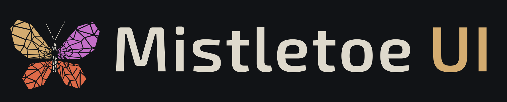
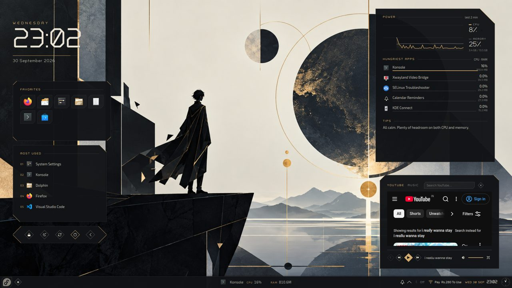
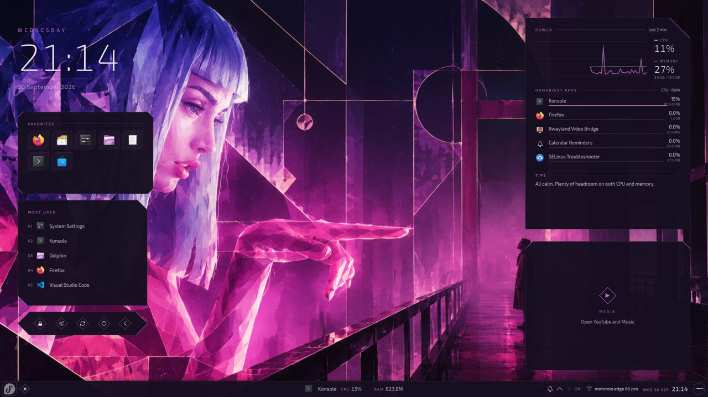
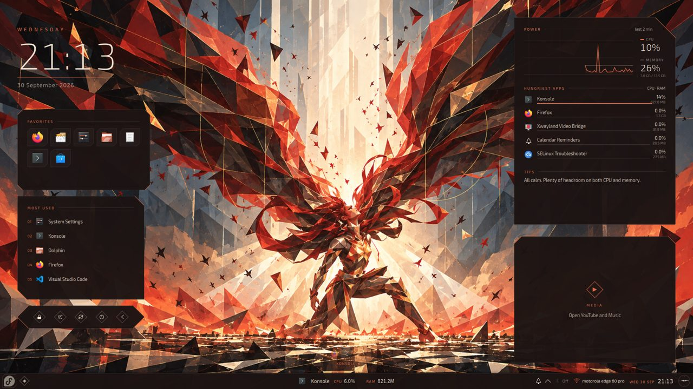
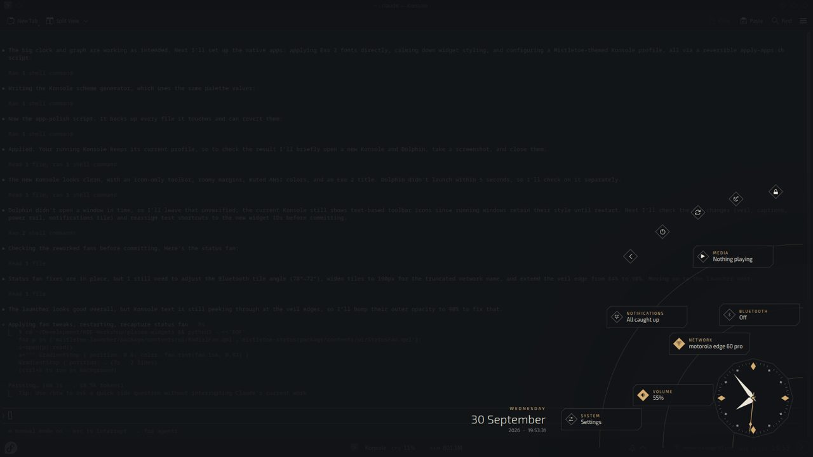
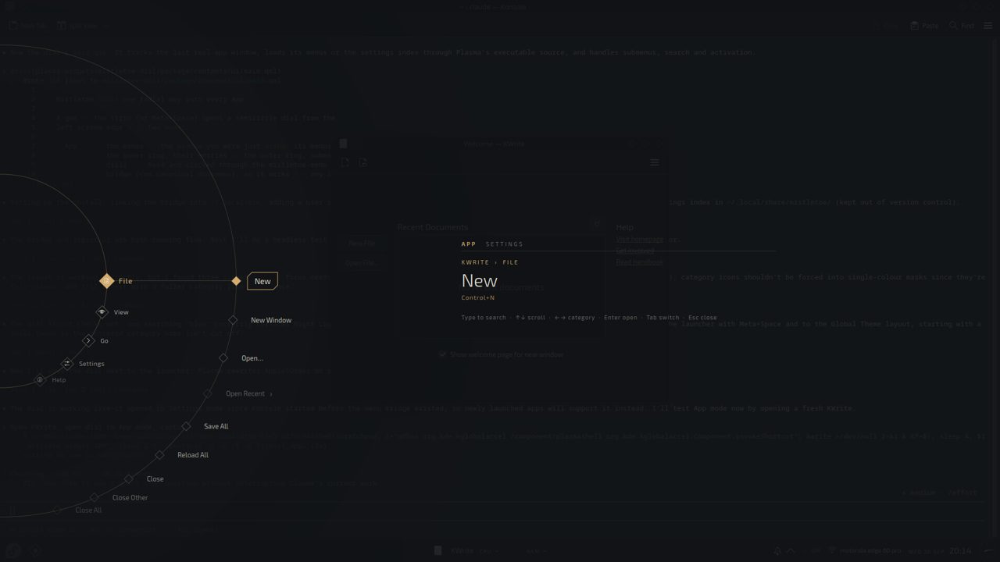
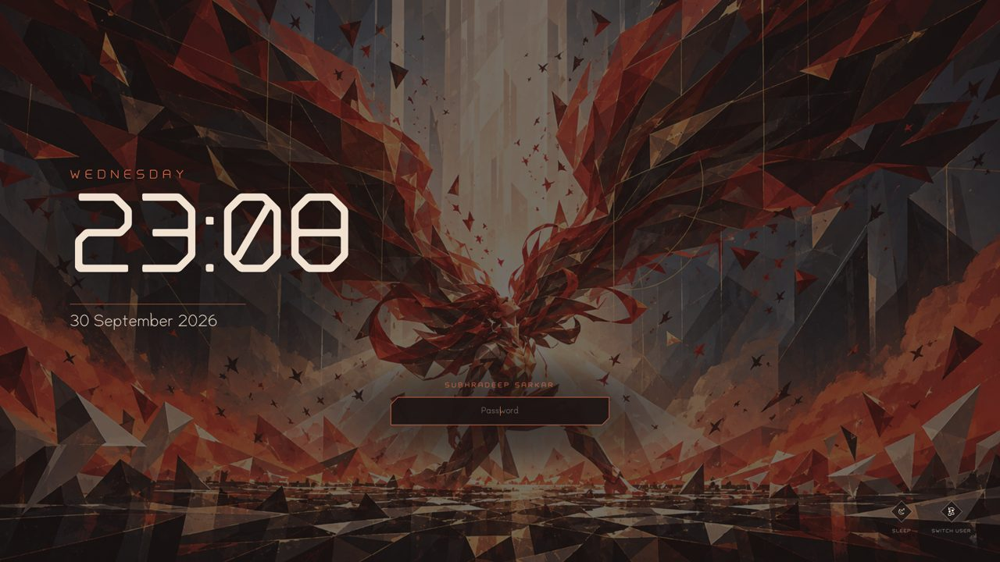

<p align="center">
  
</p>

<p align="center">
  <b>A minimal, cinematic desktop for KDE Plasma 6.</b><br>
  No taskbar. Radial menus that bloom from the screen edges. Matte, faceted surfaces cut like shards.
</p>

<p align="center">
  
</p>

---

## What it is

Mistletoe UI replaces the usual taskbar-and-menu desktop with a quiet, layered
one built on stock KDE Plasma 6 (developed on Fedora 44, Plasma 6.7, Wayland):

| Part | What you get |
|---|---|
| **The strip** | One slim matte band along the bottom: the launcher, the dial, the active app with its live CPU/RAM (hover it for all open apps on an arc), the notification bell, the date, time and a faceted clock face. |
| **Launcher fan** | Click the corner logo: apps bloom out of the corner onto gold orbits. Type to search, scroll to page, right-click to pin a favourite. |
| **Status fan** | Click the clock: Bluetooth, network, volume, media, notifications (with Do Not Disturb) and settings on two orbits, a big winding dial, and a ring of power actions. |
| **The dial** | `Meta+Space` or the gem in the strip. A rotary semicircle with three modes: the **app** you were using (its menus), your **places**, and **settings** (every System Settings page plus the Mistletoe options). Type to search. |
| **Desktop cards** | A quiet desktop: a huge clock and the date straight on the wallpaper, and one column of matching cards: a live system graph with the busiest apps, a favourites dock, and a YouTube/Music player that is only a gem until you open it. Drag, resize, or pin any card to float above your windows. |
| **Four editions** | Dark, Light, and two special editions whose palettes come from their wallpapers: **Neon** (violet and orchid) and **Ember** (charcoal and vermilion). |
| **Lock screen** | Cinematic: the clock on the left, one password shard low in the centre, branding top right. |
| **Splash and leave screens** | Log-in, splash, lock and the sleep / restart / shut-down prompt are one scene: your wallpaper under a matte veil, the clock on the left, branding top right. Only the centre changes: the password shard, a rotary dial that turns one detent per start-up stage, or the leave actions as gems. |
| **Typefaces** | Two original fonts made for Mistletoe, **Ad Astra** (futuristic, faceted) and **Mythril** (whimsical, soft), alongside Exo 2, and a switch to change which goes where. |
| **Apps** | Colour schemes, window frames, Konsole profiles and a sharp flat layer for GTK apps, so native apps match. |

<p align="center">
  
  
</p>
<p align="center">
  
  
  
</p>

### Design rules

- **Sharp and faceted.** Chamfered corners and shard shapes, never soft rounded ones.
- **Matte.** No glass, no blur anywhere. 1px hairlines and restrained shadows.
- **Small and quiet.** Nothing steals keyboard focus or covers your work unless you ask.
- **Palette** sampled from the artwork: obsidian, slate, bone and champagne gold (Neon and Ember sample their own).

---

## Install

**Requirements:** KDE Plasma 6 on Wayland, Python 3 with Pillow and PyGObject
(both are on a standard Fedora KDE install), and `kwriteconfig6`/`qdbus`
(part of Plasma).

```bash
git clone <this repo> ~/Development/KDE-Workshop
cd ~/Development/KDE-Workshop

# 1. Install: links the themes, widgets, fonts and wallpapers into ~/.local,
#    installs the lock screen and the dial's menu bridge (a user service).
bash scripts/install.sh

# 2. Apply the Global Theme with its layout (the strip and the desktop cards).
#    This replaces your current panels; your favourites are kept.
plasma-apply-lookandfeel --apply org.mistletoe.dark.desktop --resetLayout

# 3. Style the native apps: fonts, toolbars, Konsole, lock screen, GTK, Firefox.
bash scripts/apply-apps.sh
```

Optional: for GTK apps' menus to appear in the dial, run
`sudo dnf install appmenu-gtk3-module`, then log out and back in.

Everything is reversible: `bash scripts/apply-apps.sh --revert` restores the app
settings it changed, and choosing another Global Theme (e.g. Breeze) in System
Settings restores that theme. Each Mistletoe part is its own package.

---

## Using it

| To | Do |
|---|---|
| Launch an app | Click the logo bottom-left, then an app, or type its name and press `Enter`. |
| Open the dial | `Meta+Space` or the gem next to the logo. `Tab` switches App / Places / Settings, the wheel or arrow keys turn it, `Enter` opens, `Esc` closes. |
| See all open apps | Hover the app name in the middle of the strip; click an icon to switch. |
| Quick settings | Click the clock bottom-right: tiles for Bluetooth, network, volume, media, notifications and settings; power gems on the outer ring. |
| Move, resize or float a card | Hover it: drag the three gems on top to move, the corner to resize, click the pin to float it above all windows. |
| Play YouTube or music | Click the media card's play gem; the close gem unloads it again. Pin it to keep it on top while you work. |
| Lock | `Meta+L`, or the lock gem in the status fan or the power card. |

### Change edition or fonts

Open the dial, press `Tab` to **Settings**: the first groups are **Edition**
(Dark, Light, Neon, Ember) and the three font roles. Click to switch; the
current choice is marked. Or from a terminal:

```bash
mistletoe-menu edition neon              # dark | light | neon | ember
mistletoe-menu fonts display="Ad Astra"  # roles: display, accent, text
mistletoe-menu fonts accent=Mythril text="Exo 2"
```

| Font role | Default | Used for |
|---|---|---|
| Display | Ad Astra | clocks, figures, small-caps headings |
| Accent | Mythril | dates, large captions, the password hint |
| Text | Exo 2 | everyday text, and your apps' UI font |

Neon and Ember bring their own wallpapers; switching back to Dark or Light
restores the default. A wallpaper of your own stays until you change editions;
changing editions also applies that edition's wallpaper.

### Check a new app

```bash
python3 scripts/check-app.py firefox
```

reports how far Mistletoe reaches that app (colours, fonts, window frame, dial
menus) and what to do about any gaps.

---

## Repository layout

| Path | What it is |
|---|---|
| `plasma-widgets/` | The Plasma widgets: `mistletoe-launcher`, `-status`, `-arc`, `-dial`, `-dashboard` (all desktop cards). `shared/` holds components copied into each widget by `scripts/sync-shared.py`. |
| `themes/` | Plasma styles (`mistletoe-dark`, `-light`, `-neon`, `-ember`): chamfered frames, the matte strip. Generated. |
| `color-schemes/` | Colour schemes for the four editions. Generated. |
| `window-decorations/aurorae/` | Window frames: slim title bar, chamfered corner, gem buttons. Generated. |
| `lookandfeel/` | Global Themes (one per edition): defaults, the desktop layout script, previews. Generated. |
| `lockscreen/` | Lock screen source; packaged as `shells/org.mistletoe.lockscreen`. |
| `apps/mistletoe-menu/` | The bridge the widgets call: reads and clicks app menus, lists places, switches editions and fonts, measures wallpaper brightness, keeps the lock screen in sync. Plus its user service. |
| `kwin-scripts/mistletoe-edge/` | KWin helper: floating cards stay above and on screen. |
| `konsole/`, `gtk/` | Konsole profiles and colour schemes; the GTK 3/4 layer. |
| `fonts/` | Ad Astra and Mythril (original, OFL) and Exo 2 (OFL). |
| `wallpapers/` | Vigil, Raven, Colossus, Wanderer, Neon and Ember. |
| `branding/` | The Mistletoe UI logo: mark and wordmark, SVG and PNG. |
| `scripts/` | Installers and generators (see below). |
| `docs/` | Architecture, development and troubleshooting notes. |

Generated files are committed so the repo installs as-is; regenerate them with
the scripts rather than editing them by hand:

| Script | Makes |
|---|---|
| `gen-colors.py` | colour schemes and the styles' colours (with a WCAG contrast report) |
| `gen-svgs.py` | Plasma style frames |
| `gen-aurorae.py` | window decorations |
| `gen-konsole.py` | Konsole schemes and profiles |
| `gen-lookandfeel.py` | Global Themes, the layout script and the lock screen package |
| `gen-settings-index.py` | the dial's index of settings pages (per machine, at install) |
| `build-fonts.py` | Ad Astra and Mythril (needs fonttools + skia-pathops) |
| `build-logo.py` | the logo (needs fonttools + skia-pathops, ImageMagick) |
| `sync-shared.py` | copies shared QML into each widget (`--check` reports drift) |

More in [docs/architecture.md](docs/architecture.md),
[docs/development.md](docs/development.md) and
[docs/troubleshooting.md](docs/troubleshooting.md).

---

## Credits and licences

Designed and built by Subhradeep Sarkar. Widgets, scripts and the other code
are GPL-2.0-or-later; the Plasma styles are LGPL; the Ad Astra, Mythril and
Exo 2 fonts are under the SIL Open Font License 1.1 (see `fonts/*/OFL.txt`).
The wallpapers and the logo are the author's own artwork.
